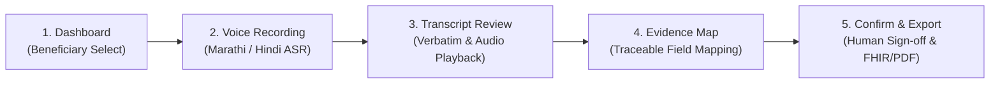

# Visit Record by Voice (भेट नोंदणी आवाज)
### AI-Powered Multilingual Healthcare Documentation Platform for Frontline ASHA Workers & ANMs in Maharashtra, India

[](https://fastapi.tiangolo.com)
[](https://react.dev)
[](https://www.typescriptlang.org)
[](https://tailwindcss.com)
[](https://www.sarvam.ai)
[](https://www.docker.com)
[](https://opensource.org/licenses/MIT)

> **Core Healthcare Principle**: *AI generates the record, evidence explains the record, and the frontline healthcare worker makes the final decision.*

Repository: **[https://github.com/Harsh746-bit/Visit_Record_by_Voice](https://github.com/Harsh746-bit/Visit_Record_by_Voice)**

---

## 1. Executive Summary & Problem Context

In rural and peri-urban Maharashtra, over 70,000 Accredited Social Health Activists (**ASHA workers**) and Auxiliary Nurse Midwives (**ANMs**) conduct daily door-to-door home visits to track maternal and child health.

### The Real-World Bottlenecks:
* **Severe Register Fatigue**: Frontline workers juggle up to 8 physical registers (RCH register, ANC book, immunization register, malnutrition cards).
* **Keyboard & Language Friction**: Typing complex medical vitals on small mobile keyboards is slow and prone to errors, especially when switching between Marathi and English medical terms.
* **Delayed Emergency Triage**: Critical danger signs like elevated blood pressure ($\ge 140/90$ mmHg with severe headache &mdash; indicative of pre-eclampsia) often go unnoticed until routine clinic days.
* **Lack of Auditability**: Hand-written entries cannot easily be audited or verified against what was actually reported during the home visit.

### The Solution:
**Visit Record by Voice (बोल. पडताळा. नोंदवा.)** empowers ASHA workers to simply speak naturally in **Marathi (मराठी)** or **Hindi (हिन्दी)**. The system transcribes the encounter, extracts clinical vitals without hallucinations, links every number directly to supporting voice evidence, triages danger signs, and produces structured FHIR-ready health records approved by human sign-off.

---

## 2. Key Capabilities & Architectural Innovations

### 1. Spoken Marathi & Hindi Speech Recognition (Sarvam Saaras v3)
* Directly captures 16 kHz Mono audio from standard mobile microphones.
* High-accuracy recognition of vernacular Devanagari mixed with standard clinical terms (e.g., *"बीपी १४०/९५"*, *"वजन ५४ किलो"*, *"IFA गोळ्या"*).
* Built-in Web Audio API real-time volume FFT visualizer and native SpeechSynthesis playback fallback.

### 2. Zero-Hallucination Traceable Evidence Attribution (Core USP)
* Rather than blindly trusting an LLM output, every extracted field (Gestational Age, BP Systolic/Diastolic, Maternal Weight, Hemoglobin, Symptoms) is strictly anchored to verbatim character offsets `[startChar, endChar]` in the spoken transcript.
* If a parameter was not spoken during the encounter, it is explicitly flagged as **Missing / Not Reported** rather than fabricated.

### 3. Independent Rule-Based Clinical Triage Engine
* Operates according to ICMR and National Health Mission (NHM) guidelines:
  * **Pre-eclampsia Alert**: Blood Pressure $\ge 140/90$ mmHg accompanied by headache or blurred vision triggers an urgent PHC referral alert.
  * **Severe / Moderate Anemia**: Hemoglobin $< 11.0$ g/dL flags IFA counseling and dietary follow-up.
  * **Pedal Edema & Decreased Fetal Movement**: Highlighted as high-risk flags in the supervisor review queue.

### 4. Mandatory Human-in-the-Loop Sign-off
* AI is strictly assistive. A certified healthcare worker must review the evidence table, edit any discrepancies, and explicitly check the digital declaration before the record is saved or synced.

### 5. Instant Multilingual Localization
* Full, seamless support across **मराठी (`mr`)**, **हिन्दी (`hi`)**, and **English (`en`)** throughout the entire application &mdash; navigation, clinical field tables, speech guides, and supervisor analytics.

### 6. Interactive Visual Documentation Volume Analytics
* Rich Recharts-powered `ComposedChart` analyzing daily documentation volume:
  * **Marathi Voice Notes** vs. **Hindi Voice Notes** stacked comparison.
  * **Verified Records Conversion Trendline** (averaging 93.2% conversion).
  * **High-Risk Triage Danger Sign** alerts.

---

## 3. The 5-Step Frontline Workflow Roadmap



| Step | Screen | User Action | Clinical / AI Output |
| :--- | :--- | :--- | :--- |
| **1** | **Dashboard** | ASHA selects registered mother (e.g., Sunita Shinde, RCH ID). | Displays gestational stage, past visits, and high-risk tags. |
| **2** | **Voice Encounter** | Tap microphone and speak visit summary in Marathi or Hindi. | Real-time waveform visualizer, 16 kHz audio capture, file upload option. |
| **3** | **Transcript Review** | Review transcribed Devanagari text, play back audio, or edit typos. | Verbatim transcript generated via Sarvam Saaras v3 Indic ASR. |
| **4** | **Evidence Mapping** | Inspect extracted vitals side-by-side with supporting phrases. | Field-level character spans, Pre-eclampsia alert banner, missing field flags. |
| **5** | **Confirm & Export** | Review encounter card, check sign-off box, and export. | 1-click Download (PDF, FHIR JSON, CSV) & sync to PHC database. |

---

## 4. Technology Stack

### Frontend Application
* **Framework**: React 19, TypeScript, Vite 8.3
* **Styling**: Tailwind CSS v4, Custom High-Contrast Healthcare Color Tokens
* **Visualizations & Charts**: Recharts 3.10 (`ComposedChart`, `Area`, `Bar`, `Line`)
* **Icons**: Lucide React
* **Speech & Audio**: Web Audio API (AnalyserNode FFT), MediaRecorder API, HTML5 Audio, Web Speech API fallback

### Backend API
* **Language & Framework**: Python 3.10+, FastAPI, Pydantic v2
* **Server**: Uvicorn (ASGI)
* **Databases**: SQLite (Local Dev) / PostgreSQL 16 (Production Docker)
* **Authentication**: JWT (Access + Refresh tokens) with password hashing (bcrypt)
* **Speech Integration**: Sarvam Saaras v3 ASR REST integration

### Containerization & Deployment
* **Docker**: Multi-stage production `Dockerfile.backend` and `Dockerfile.web` (Nginx Alpine)
* **Orchestration**: `docker-compose.yml` (PostgreSQL, Backend API, Frontend Nginx)

---

## 5. Repository Structure

```
visit-record-by-voice/
├── .env.example                     # Environment template (Sarvam API key, JWT secrets)
├── .gitignore                       # Clean gitignore excluding secrets, DBs, and binaries
├── docker-compose.yml               # Production multi-container composition
├── Dockerfile.backend               # FastAPI production Dockerfile
├── Dockerfile.web                   # Nginx + React 19 production Dockerfile
├── README.md                        # Project documentation and guide
│
├── backend/                         # FastAPI Python Backend
│   ├── app/
│   │   ├── main.py                  # API router, CORS, and WebSocket configuration
│   │   ├── api/v1/endpoints/        # Auth, Visits, Speech, Beneficiaries, Workers routes
│   │   ├── core/                    # Security, JWT tokens, config settings
│   │   ├── models/                  # SQLAlchemy database models
│   │   ├── schemas/                 # Pydantic schemas (Visit, EvidenceSpan, Vitals)
│   │   └── services/                # Sarvam ASR integration, clinical rules engine
│   ├── requirements.txt             # Python dependencies
│   └── test_api.py                  # Automated test suite
│
└── web/                             # React 19 + Vite Frontend
    ├── src/
    │   ├── App.tsx                  # Root app (ASHA Flow, ANM Portal, Dual-View)
    │   ├── components/
    │   │   ├── common/Header.tsx    # Header with mobile menu & language switcher
    │   │   └── ui/                  # StatCard, StatusBadge, NotificationPanel
    │   ├── features/
    │   │   ├── asha/                # 5-step ASHA Visit Flow view
    │   │   ├── dashboard/           # ANM Clinical Overview & Documentation Volume Chart
    │   │   ├── beneficiaries/       # Beneficiary Management & RCH Registry
    │   │   ├── evidence/            # Split Evidence Review view
    │   │   ├── visits/              # Visit records queue
    │   │   ├── simulator/           # Smartphone frame simulator
    │   │   └── auth/LoginView.tsx   # Login and Guest Mode gate
    │   ├── i18n/translations.ts     # Complete Marathi, Hindi & English schema
    │   ├── services/                # Typed apiClient & liveDataService
    │   └── types/index.ts           # Shared TypeScript interfaces
    ├── package.json
    └── vite.config.ts
```

---

## 6. Getting Started & Installation

### Prerequisites
* **Node.js**: v18 or v20+
* **Python**: v3.10+
* **Git**: Installed and configured
* **Sarvam AI API Key**: Obtain a key from [dashboard.sarvam.ai](https://dashboard.sarvam.ai/)

---

### Method A: One-Command Docker Compose (Recommended)

1. Clone the repository:
   ```bash
   git clone https://github.com/Harsh746-bit/Visit_Record_by_Voice.git
   cd Visit_Record_by_Voice
   ```

2. Configure environment:
   ```bash
   cp .env.example .env
   # Add your SARVAM_API_KEY in .env
   ```

3. Launch all services:
   ```bash
   docker compose up -d --build
   ```
   * **Frontend Web App**: `http://localhost:3000`
   * **Backend REST API**: `http://localhost:8000`
   * **Interactive API Docs**: `http://localhost:8000/docs`

---

### Method B: Manual Local Development

#### 1. Setup Backend (FastAPI):
```bash
# Navigate to backend directory
cd backend

# Create virtual environment
python -m venv venv
# On Windows:
.\venv\Scripts\activate
# On Linux/macOS:
source venv/bin/activate

# Install dependencies
pip install -r requirements.txt

# Run backend API server
python -m uvicorn backend.app.main:app --host 127.0.0.1 --port 8000 --reload
```

#### 2. Setup Frontend (React 19 + Vite):
```bash
# In a new terminal, navigate to web directory
cd web

# Install dependencies
npm install

# Start Vite dev server
npm run dev
```

Open **`http://localhost:5173`** in your browser.

---

## 7. Key REST API Endpoints

| Method | Endpoint | Description |
| :--- | :--- | :--- |
| `POST` | `/api/v1/auth/login` | Authenticate healthcare worker and return JWT token |
| `POST` | `/api/v1/speech/transcribe` | Convert spoken audio file (WAV/WebM) to text via Sarvam Saaras v3 |
| `POST` | `/api/v1/clinical/extract` | Extract structured clinical vitals with character-offset evidence spans |
| `GET` | `/api/v1/visits/` | List all visits with status (`pending`, `reviewed`, `returned`) |
| `POST` | `/api/v1/visits/` | Save confirmed visit record with evidence spans and danger alerts |
| `GET` | `/api/v1/beneficiaries/` | Retrieve RCH-registered antenatal and postnatal mothers |
| `GET` | `/api/v1/workers/` | Get ASHA field workers directory with daily coverage metrics |
| `GET` | `/docs` | Interactive Swagger / OpenAPI documentation |

---

## 8. Clinical Verification Rules Reference

The independent rule engine executes the following logic during audio extraction:

$$\text{Pre-Eclampsia Risk} = (\text{Systolic BP} \ge 140 \lor \text{Diastolic BP} \ge 90) \land (\text{Headache} = \text{True} \lor \text{Edema} = \text{True})$$

$$\text{Anemia Severity} = \begin{cases} 
\text{Severe Alert}, & \text{if } \text{Hb} < 7.0 \text{ g/dL} \\
\text{Moderate Risk}, & \text{if } 7.0 \le \text{Hb} < 10.0 \text{ g/dL} \\
\text{Mild Risk}, & \text{if } 10.0 \le \text{Hb} < 11.0 \text{ g/dL} \\
\text{Normal}, & \text{if } \text{Hb} \ge 11.0 \text{ g/dL}
\end{cases}$$

---

## 9. License & Attribution

This project is released under the **MIT License**.

Built for frontline healthcare workers serving rural communities across Maharashtra.  
*बोल • पडताळा • नोंदवा &mdash; Speak. Verify. Record.*
