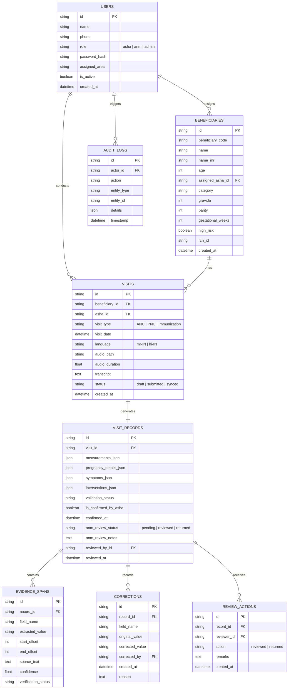

# Database Schema Specification — Visit Record by Voice

## Relational Entity-Relationship Diagram

---

## Table Constraints & Indexing Strategy
- `VISITS(beneficiary_id, visit_date)`: B-tree index for fast patient timeline retrieval.
- `VISIT_RECORDS(anm_review_status)`: Indexed for fast supervisor queue filtering.
- `EVIDENCE_SPANS(record_id, field_name)`: Composite index for instant evidence lookups.
- Foreign Keys enforced across all relationship tables with `ON DELETE RESTRICT` to preserve medical auditability.
